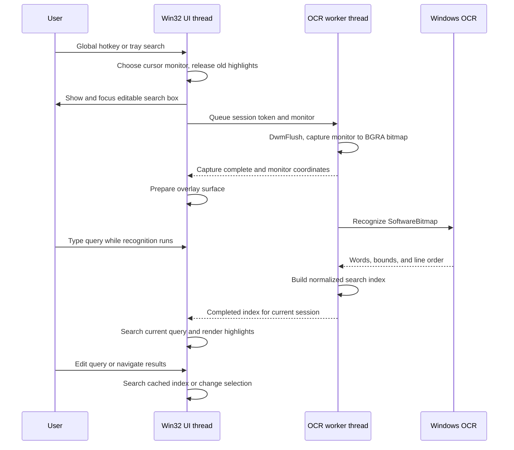

# Architecture

Visual Find is a C++20 desktop process using Win32 for its message loop and controls, GDI for monitor capture, Windows OCR through generated C++/WinRT headers, and a layered Win32 window for highlights. GCC and its C++ runtime components are linked statically. Windows system DLLs provide the operating-system services.

## Session flow

The search box is shown and focused synchronously during hotkey handling, while Windows grants foreground activation to the hotkey recipient. The app requests `WDA_EXCLUDEFROMCAPTURE` for the search window only until screen pixels have been copied, then restores `WDA_NONE`. Highlights are hidden before refresh. This lets OCR read behind the bar while normal screenshots include both the bar and highlights. Capture, OCR, and index construction run on one persistent worker thread. Typing during recognition is accepted by the edit control; when the index arrives, the UI searches the text currently in that control. Query edits thereafter do not request more OCR.

The three-dot grip and noninteractive parts of the floating window return the native caption hit-test result, letting Windows handle mouse dragging. Edit and button rectangles retain normal client hit tests. Starting another search positions the window at the default upper-right offset on the cursor monitor; dragged positions are not remembered between sessions.

## Responsibilities

| File | Responsibility |
| --- | --- |
| `src/app.cpp` | Arguments, instance guard, global hotkey, tray menu, controls, session lifetime, worker queue, message dispatch, and diagnostic smoke mode. |
| `src/platform.hpp` | GDI buffer ownership, cursor-monitor selection, capture, physical coordinate mapping, DPI setup, and timing helpers. |
| `src/accessible.hpp` | UI Automation reader: visible text runs (text, links, buttons) of the window in front and the one under the cursor, visibility filtering, and placement of each run's words on the lines drawn in the capture. |
| `src/layout.hpp` | Pure functions: finds text lines and word gaps from pixels (`inkLines`) and spreads a run's words along them (`spreadWords`). |
| `src/desktop.hpp` | Optional local accessibility names and physical bounds for visible Explorer desktop shortcuts, merged once into the cached index. |
| `src/ocr.hpp` | Lazy creation of the Windows OCR engine, language selection, BGRA-to-SoftwareBitmap memory copy, recognition, and extraction of word boxes. |
| `src/search.hpp` | Unicode/whitespace normalization, text-to-word spans, substring and phrase matching, and highlight regions. |
| `src/overlay.hpp` | Click-through, non-activating, topmost layered window and premultiplied BGRA highlight rendering. |
| `src/app.manifest` | Per-monitor V2 DPI awareness, x64 identity, and execution with the caller's privileges. |
| `build.ps1` | Pinned C++/WinRT build tool, projection generation, compilation, search tests, and portable packaging. |

## Capture, OCR, and coordinates

Each activation selects the monitor containing the cursor, falling back to the nearest monitor. Capture uses the monitor's physical desktop rectangle, including negative origins. The search box is positioned in its work area with monitor-specific UI DPI scaling.

`captureScreen` creates a top-down, 32-bit BGRA DIB. It uses `BitBlt` at native size, or `StretchBlt` with aspect-preserving reduction only when required by `OcrEngine::MaxImageDimension`. The capture records the actual integer image dimensions. OCR boxes are mapped back with separate X and Y ratios plus the monitor's desktop origin, avoiding assumptions about a single global DPI scale.

The OCR worker owns a multithreaded WinRT apartment. Engine initialization is deferred until recognition. An explicit `--language` must be installed; otherwise the app tries user-profile languages and then the first available recognizer. The GDI pixels are copied into a `SoftwareBitmap` buffer without image encoding or filesystem writes, and the original capture buffer is released before `RecognizeAsync(...).get()` returns. That wait blocks the worker thread, while the UI continues processing messages.

For sessions started with Explorer's desktop focused, the worker also reads `IAccessible` names and physical item bounds from the desktop list view. It ignores hidden/off-screen items, items outside the selected monitor, and items covered by other windows. The temporarily capture-excluded search window is allowed above an otherwise visible desktop item. Exact shortcut names replace OCR readings inside their regions before indexing, preventing duplicated or misspelled shortcut matches. This happens once per capture; typing still searches only the cached index. The highlight covers the shortcut's full icon-and-label bounds, and the name may include text that Explorer abbreviates visually. These names stay in memory alongside OCR words and are released when the session closes. Other application sessions retain the ordinary OCR path.

OCR output stores word strings, desktop boxes, and line identifiers. The implementation uses the returned axis-aligned word rectangles and does not apply an extra correction from OCR's text angle. OCR reading order and recognition accuracy constrain the resulting index.

## Search and rendering

The index applies Windows Unicode compatibility normalization (NFKC), invariant lowercase conversion, and whitespace collapsing. Recognized words are joined with single spaces; character spans map portions of this normalized text back to OCR boxes and line identifiers. Queries undergo the same normalization.

Search uses `std::wstring::find` and advances to the end of each occurrence, producing non-overlapping substring matches. A phrase may cross words and lines because the searchable text follows OCR order. Spans intersecting a hit supply the highlight boxes: boxes on the same OCR line are merged, while wrapped phrases retain separate line regions. A hit inside a word still uses that word's full box.

The overlay uses physical-resolution, four-byte-per-pixel pixels within the padded union of the matches, clipped to the selected monitor. It allocates a surface when matches exist and reuses it when its dimensions remain the same. Each render clears that surface, draws yellow match rectangles and a blue selected rectangle, then submits it with `UpdateLayeredWindow` at the corresponding desktop origin. Its transparent and non-activating styles pass input through. Refresh releases old highlights before capture. Search-bar capture exclusion lasts only until pixels are copied, including restoration on failure or dismissal; highlights are not capture-excluded. Normal screenshots can therefore show the completed search.

The selected result is represented by an index into the match vector. Enter and Shift+Enter change it with wraparound and repaint; they do not move the pointer, scroll a target application, or interact with its document model.

## Lifetime and concurrency

A named mutex in the current Windows session prevents duplicate instances. A second launch sends an activation message to the existing search window, which begins a new session. The hidden search window receives the global hotkey and tray callbacks while idle. The worker waits on a condition variable when no capture is requested; there is no continuous desktop scan.

The worker queue retains the latest pending job. A monotonically increasing token identifies each session; refresh, close, and shutdown invalidate earlier jobs. Both worker and UI check tokens before accepting results. This prevents a delayed recognition result from reopening a dismissed session or replacing a refreshed index. It does not cancel an OCR call already executing: the worker finishes it, discards stale results, then processes the latest pending job.

Esc, the close button, focus loss, and display changes hide both windows and release the session index and overlay surface. An explicit close attempts to return focus to the original application when appropriate. Focus-loss dismissal leaves focus with the newly selected application. F5 keeps the query, clears old highlights, and captures the current cursor monitor again.

Tray exit unregisters the hotkey and removes the icon. Destruction wakes and joins the worker before destroying its message target, then releases any queued result objects and GDI resources. Normal sessions retain no screenshot or OCR text on disk; diagnostic modes write measurements and outcomes.

## Validation boundaries

Search tests cover normalization, phrase and substring behavior, line-region grouping, image scaling, and negative monitor coordinates using synthetic OCR words. They do not exercise the installed OCR engine or physical displays.

The benchmark and application matrix use visible fixtures to exercise the capture/OCR path and selected UI behavior on an interactive desktop. See [performance](performance.md) and `application-test-results.json` for recorded results, hardware context, and untested cases. Those observations are not guarantees for arbitrary fonts, languages, applications, display layouts, or protected surfaces.

## Scroll refresh

While a session is active the app installs a `WH_MOUSE_LL` hook that only posts a message on wheel events. The UI thread hides the highlights, then debounces (200 ms idle, 1 s maximum) into a normal capture/OCR job via the existing token/worker path, preserving the query and window position. The hook and timers are removed when the session closes. Events over the search bar or on other monitors are ignored.

## Two lanes: OCR and exact text

A session queues one job for each of two persistent threads. The **OCR lane** captures the monitor, publishes the screenshot (shared, read-only) and recognizes it on up to four horizontal strips at once, with one `OcrEngine` per strip (strips overlap by 64 px; a word belongs to the strip holding its vertical centre). Its result is posted at once; only when it found little or very small text does it recognize an enlarged copy of the same pixels (no second capture), and it skips that when the text lane has already supplied at least 20 exact words. The **text lane** queries UI Automation while the capture is being taken, waits briefly for the screenshot, and finds each run's lines and word gaps in it. Browsers build their accessibility tree on first request, so the lane retries for up to about a second when a browser reports no page yet.

The UI thread keeps the latest OCR words and exact text, and on each arrival merges them (`mergeExactText`: OCR words whose centres fall inside exact-text rectangles are dropped) and rebuilds the index, then re-applies the current query. Both lanes use the session token, so stale results are discarded.
